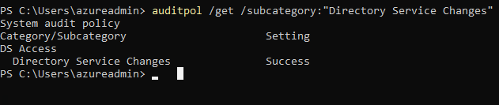
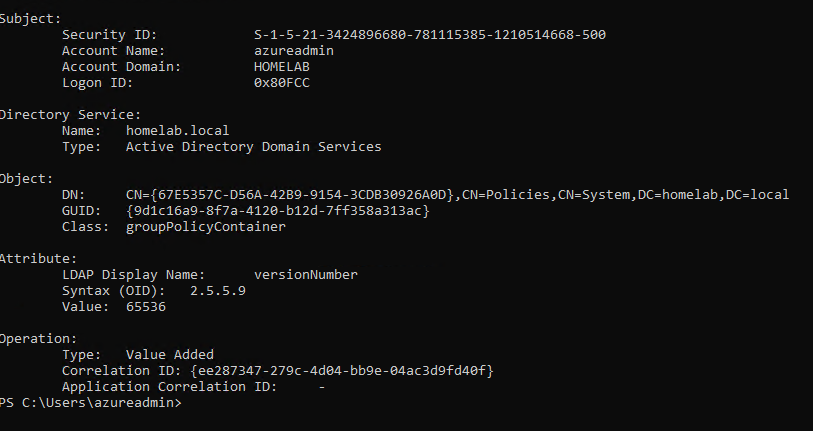
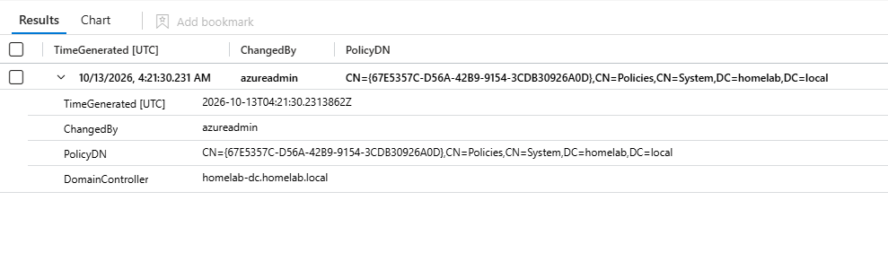

# Detection: GPO Change Monitoring

## Why this one

Group Policy controls a lot of what happens on every machine in a domain: security settings, scripts, software, firewall rules. For an IT team, an unexpected GPO change is a classic cause of "it worked yesterday" tickets. For a security team, it is also a way for someone with enough access to push changes to every machine at once. Either way, the first questions are the same: who changed a policy, and when.

## Turning on the logging

My first check was whether the domain controller would even record this. It would not:

```powershell
auditpol /get /subcategory:"Directory Service Changes"
```

It said No Auditing. The change would have happened with nothing in the logs. I turned it on for successful changes and checked again:

```powershell
auditpol /set /subcategory:"Directory Service Changes" /success:enable
auditpol /get /subcategory:"Directory Service Changes"
```



This was the most useful thing I learned here. A detection depends on the logging being on first, and on a fresh domain controller it was not.

## Simulating it

I made a test policy and changed a setting in it:

```powershell
New-GPO -Name "Lab Test Policy"
Set-GPRegistryValue -Name "Lab Test Policy" -Key "HKCU\Software\LabTest" -ValueName "Test" -Type String -Value "changed"
```

## What the domain controller logged

One edit produced three 5136 events, all sharing a correlation ID. They are one change recorded in pieces: the version number deleted, the new one added, and a list of policy extensions updated. To read them I used `Get-WinEvent` on the Security log for event 5136.



The event shows azureadmin as the Subject, a groupPolicyContainer as the object, and versionNumber going to 131072 with the operation Value Added. That number is how AD counts edits. The top half counts user setting changes, so 131072 means two edits to a user setting, which matches my two tests.

The policy shows up as a GUID in the object path, not as "Lab Test Policy". AD identifies policies by GUID, and you look up the name with `Get-GPO -Guid`.

## The detection

I keyed on versionNumber being added, because it changes once per edit while the other attributes change only sometimes.

```kusto
SecurityEvent
| where EventID == 5136
| extend ObjectClass = extract(@'Name="ObjectClass">([^<]+)<', 1, EventData),
         Attribute = extract(@'Name="AttributeLDAPDisplayName">([^<]+)<', 1, EventData),
         Operation = extract(@'Name="OperationType">([^<]+)<', 1, EventData),
         PolicyDN = extract(@'Name="ObjectDN">([^<]+)<', 1, EventData),
         ChangedBy = extract(@'Name="SubjectUserName">([^<]+)<', 1, EventData)
| where ObjectClass == "groupPolicyContainer" and Attribute == "versionNumber" and Operation == "%%14674"
| project TimeGenerated, ChangedBy, PolicyDN, DomainController = Computer
| sort by TimeGenerated desc
```



One row came back for my change: azureadmin, the policy's GUID, and homelab-dc. The values come out of the raw event XML with `extract()`, the same approach as my Kerberoasting query. The operation is logged as a code, and `%%14674` means Value Added. Sentinel shows time in UTC, so the change shows as 04:21 on the 13th, and my clock said 9:21 PM on the 12th.

The first change I made was not collected, because the agent on the domain controller had to be reinstalled, so I repeated the edit once it was back.

## What this does not tell you

- It says that a policy changed and who changed it, not what changed inside it. A real investigation would compare the policy before and after.
- It shows a GUID, so someone has to look up which policy that is.
- It does not cover linking a policy to an OU or the domain, which is a different attribute. That would need its own check.
- Most GPO edits are normal admin work. A hit is a question for whoever made the change, not proof of anything.
- I only tested one account making one kind of edit.

## ATT&CK mapping

T1484.001, Domain Policy Modification: Group Policy Modification. It applies when an attacker edits a GPO to push changes across the domain. In a lab or a real help desk, though, nearly every hit is a normal edit, so this detection serves the IT reading of the event as much as the security one.

## What I would do differently next time

I would turn this into an analytics rule so it alerts, and exclude the admin accounts that are expected to make changes, so only unexpected editors stand out. I would also resolve the GUID to the policy name in the output, and add a check for policy links changing, since that is the other half of how a GPO takes effect.
